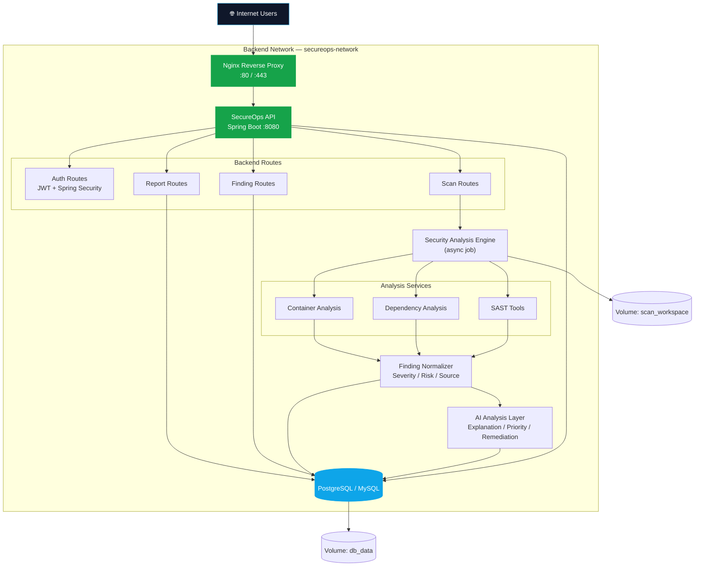
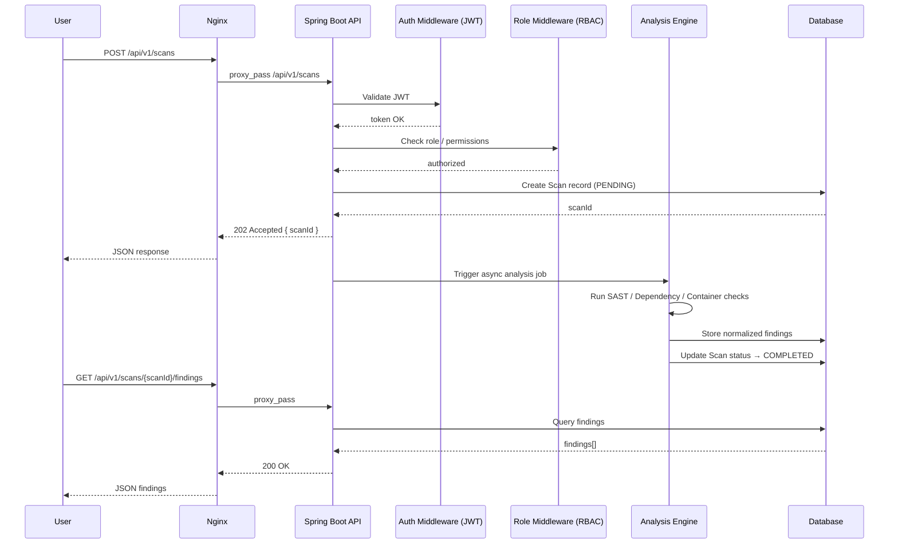
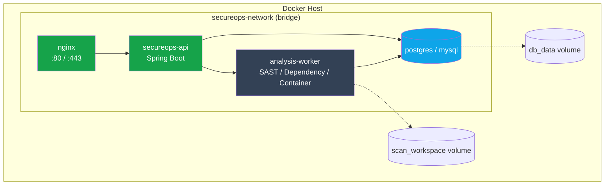

# SecureOps AI

### AI-Assisted Security Assessment Platform.

SecureOps AI is a Java-based DevSecOps platform designed to identify security vulnerabilities in ** applications** and provide actionable security insights.

The project focuses on building a production-oriented **Spring Boot backend** that can orchestrate security analysis, process vulnerability findings, and eventually use AI to explain and prioritize identified issues.

---

## 1. Problem Statement

Security analysis is often performed manually or through multiple independent tools, making it difficult for developers to understand:

* Which vulnerabilities are critical
* Where they exist in the application
* What caused them
* How they should be fixed
* Which issues should be addressed first

SecureOps aims to provide a centralized backend workflow for analyzing Java applications and converting security findings into actionable information.

---

## 2. Project Goals

### Primary Goal

Build a platform that can automatically identify security vulnerabilities in Java/Spring Boot applications.

### Initial Scope

* Analyze Java/Spring Boot applications
* Detect common security vulnerabilities
* Collect and normalize security findings
* Assign severity and risk information
* Expose findings through REST APIs
* Containerize the platform using Docker
* Establish a foundation for CI/CD integration
* Add AI-assisted vulnerability explanation and prioritization

---

## 3. System Architecture



**Network:** all backend services communicate over a shared bridge network (`secureops-network`), with named volumes for `db_data` and `scan_workspace` (temporary checked-out repos / scan artifacts) persisting across container restarts.

> Components in the Analysis Services and AI Analysis Layer are part of the planned roadmap (Phase 3 / Phase 5), not completed functionality yet. The diagram reflects the target production topology.

### Request Lifecycle — Submit Scan



---


## 5. Core Workflow

### Step 1 — Submit Application

A user submits a Java/Spring Boot application or repository for analysis.

```http
POST /api/v1/scans
```

Example:

```json
{
  "projectName": "sample-spring-app",
  "repositoryUrl": "repository-url"
}
```

### Step 2 — Create Scan

SecureOps creates a scan record and assigns it a unique scan ID.

```text
Scan
 ├── ID
 ├── Project
 ├── Status
 ├── CreatedAt
 └── CompletedAt
```

### Step 3 — Security Analysis

The analysis engine executes the configured security checks against the application.

Initially, the focus will be on **Java/Spring Boot security analysis**.

### Step 4 — Normalize Findings

Different security tools can produce different output formats.

SecureOps will normalize them into a common finding model.

```text
Finding
 ├── Title
 ├── Description
 ├── Severity
 ├── Category
 ├── Source
 ├── File
 ├── Line
 └── Remediation
```

### Step 5 — AI Analysis

The AI layer will consume normalized findings and provide:

* Vulnerability explanation
* Risk interpretation
* Suggested remediation
* Finding prioritization

### Step 6 — Report

The final results will be available through REST APIs and eventually through a report/dashboard layer.

---

## 6. Initial REST API Design

### Scan API

```http
POST   /api/v1/scans
GET    /api/v1/scans
GET    /api/v1/scans/{scanId}
```

### Findings API

```http
GET    /api/v1/scans/{scanId}/findings
GET    /api/v1/findings/{findingId}
```

### Reports API

```http
GET    /api/v1/scans/{scanId}/report
```

The API design will evolve as the backend implementation progresses.

---

## 7. Security Analysis

The security engine is planned to support multiple analysis categories.

### Source Code Analysis

Identify vulnerabilities in application source code.

Potential focus areas:

* Injection vulnerabilities
* Insecure API usage
* Authentication/authorization issues
* Hardcoded secrets
* Unsafe coding patterns

### Dependency Analysis

Analyze project dependencies for known vulnerabilities.

For Maven-based Spring Boot applications:

```text
pom.xml
   ↓
Dependency Analysis
   ↓
Known Vulnerabilities
   ↓
Normalized Findings
```

### Container Analysis

The platform will eventually analyze Docker images associated with the application.

```text
Spring Boot Application
        ↓
     Docker Build
        ↓
    Docker Image
        ↓
 Security Analysis
        ↓
 Vulnerability Findings
```

---

## 8. Docker Architecture

SecureOps itself will be containerized to provide a reproducible development and deployment environment.



Docker Compose will initially be used for local development and service orchestration, mirroring this topology (`nginx`, `secureops-api`, `analysis-worker`, `db`, plus named volumes) before migrating to Kubernetes in Phase 7.


## 10. Technology Stack

### Backend

* Java 21
* Spring Boot 4.1.1
* Spring Security
* Spring Data JPA
* REST APIs
* Maven
* Jackson (JSON parsing)
* Lombok

### Database

* PostgreSQL 18+

### Security

* Trivy (CVE/Container analysis) - Phase 6 integrated
* Future: Semgrep (SAST), OWASP Dependency Check
* Secret detection
* Container scanning

### DevOps

* Git
* GitHub
* Docker
* Docker Compose
* Maven
* Tomcat (embedded)

### AI

* LLM-based vulnerability explanation (planned)
* Risk prioritization (planned)
* Remediation assistance (planned)

---

## 11. Development Roadmap

### Phase 0 — Foundation (✅ Complete)
* [x] Spring Boot 4.1.1 project with Java 21
* [x] PostgreSQL connectivity with HikariCP
* [x] Health check endpoint (`GET /api/health`)
* [x] Database auto-initialization (ddl-auto=update)

### Phase 1 — Project Management (✅ Complete)
* [x] Project entity with UUID primary key
* [x] ProjectRepository (Spring Data JPA)
* [x] ProjectService (CRUD operations)
* [x] ProjectController (3 endpoints: POST, GET all, GET by ID)
* [x] Duplicate project prevention (unique constraint on name)
* [x] Global exception handling

### Phase 2 — Pipeline Management (✅ Complete)
* [x] Pipeline entity with foreign key to Project
* [x] PipelineProvider enum (JENKINS, GITHUB_ACTIONS, etc.)
* [x] PipelineService with project validation
* [x] PipelineController (3 endpoints)
* [x] Duplicate pipeline prevention (composite unique constraint)

### Phase 3 — Scan Management (✅ Complete)
* [x] Scan entity with dual FKs (Project, Pipeline)
* [x] Environment enum (DEVELOPMENT, STAGING, PRODUCTION)
* [x] ScanStatus enum (CREATED, PROCESSING, COMPLETED, FAILED)
* [x] Three-step cross-project security validation
* [x] Unique constraint allowing multiple scans per pipeline in different environments

### Phase 4 — Report Ingestion (✅ Complete)
* [x] Report entity with FK to Scan
* [x] ReportTool enum (TRIVY, SEMGREP, OWASP_DEPENDENCY_CHECK)
* [x] ReportStatus enum (RECEIVED, PROCESSING, PROCESSED, FAILED)
* [x] Multipart file upload to `/api/scans/{scanId}/reports?tool=TRIVY`
* [x] Filesystem storage strategy (./reports/{scanId}/{tool}/{timestamp}_{filename})
* [x] Unique constraint (one report per tool per scan)

### Phase 5 — Finding Domain (✅ Complete)
* [x] Finding entity with dual FKs (Scan, Report)
* [x] Severity enum (CRITICAL, HIGH, MEDIUM, LOW)
* [x] FindingStatus enum (OPEN, RESOLVED)
* [x] FingerprintService with deterministic SHA-256 hashing
* [x] FindingService (CRUD + cross-project validation)
* [x] FindingController (GET/POST endpoints)
* [x] APIs: GET findings by scan, GET specific finding, POST create finding

### Phase 6 — Trivy Report Parsing (✅ Complete)
* [x] SecurityReportParser interface for pluggable parsers
* [x] TrivyParser implementation with field mapping
* [x] Jackson POJOs (TrivyReport, TrivyResult, TrivyVulnerability)
* [x] ReportProcessingService orchestrating parsing and persistence
* [x] API: `POST /api/scans/{scanId}/reports/{reportId}/process`
* [x] Edge case handling (missing fields, unknown severity, malformed JSON)
* [x] Sample Trivy JSON with multiple targets and vulnerabilities
* [x] Report status tracking (RECEIVED → PROCESSING → PROCESSED)

### Phase 7 — Deterministic Risk Engine (✅ Complete)
* [x] RiskScore DTO with findings count by severity
* [x] RiskEngine service with weighted scoring
* [x] Severity weights (CRITICAL=10, HIGH=7, MEDIUM=4, LOW=1)
* [x] RiskController with GET `/api/scans/{scanId}/risk` endpoint
* [x] Deterministic and reproducible calculation
* [x] Comprehensive logging and error handling

### Phase 8 — Configurable Security Policy System (✅ Complete)
* [x] Policy entity with project + environment + thresholds
* [x] PolicyEnvironment enum (DEVELOPMENT, STAGING, PRODUCTION)
* [x] PolicyRepository with custom queries
* [x] PolicyService with CRUD operations + validation
* [x] PolicyController with REST endpoints (POST, GET, PUT)
* [x] PolicyEngine for policy evaluation
* [x] Project-level isolation (different projects, different policies)
* [x] Database-driven policies (not hardcoded)
* [x] Validation for negative thresholds and missing projects

### Phase 9 — SecurityDecision & Policy Enforcement (✅ Complete)
* [x] SecurityDecision entity with PASS/BLOCK decision
* [x] Combines findings + risk + policy to generate verdict
* [x] Deterministic decision logic (no AI, reproducible)
* [x] Detailed decision reasoning (why PASS or BLOCK)
* [x] One decision per scan (unique constraint)

### Phase 11 — Real Jenkins Integration (✅ Complete)
* [x] Find project by name endpoint (`GET /api/projects?name={name}`)
* [x] Verified all Phase 10 APIs for Jenkins compatibility
* [x] Duplicate pipeline prevention with 409 Conflict response
* [x] Error handling for all scenarios (404, 409, 400, 500)
* [x] Complete Jenkins workflow documentation
* [x] Full Jenkinsfile example with error handling
* [x] Jenkins integration testing guide
* [x] Comprehensive troubleshooting documentation

### Phase 10 — Finding Deduplication (Planned)
* [ ] Cross-scan fingerprint matching
* [ ] Vulnerability lifecycle tracking (NEW, PERSISTENT, RESOLVED, REGRESSED)
* [ ] Finding correlation across multiple scans

### Phase 10 — Risk & Policy (Planned)
* [ ] Risk scoring (CVSS integration)
* [ ] SLA-based remediation policies
* [ ] Auto-resolution based on policy

### Phase 11 — AI Layer (Planned)
* [ ] LLM integration for vulnerability explanation
* [ ] Risk prioritization
* [ ] Remediation suggestions

### Phase 12 — Kubernetes Deployment (Planned)
* [ ] Kubernetes manifests
* [ ] Service and ingress configuration
* [ ] Persistent storage configuration
* [ ] Helm charts

---

## 12. Current Status

**Current phase: Phase 11 — Real Jenkins Integration (Complete)**

Completed phases:
- Phase 0: Spring Boot health checks and database connectivity
- Phase 1: Project management with multi-tenancy
- Phase 2: Pipeline management per project
- Phase 3: Scan management with cross-project isolation
- Phase 4: Report ingestion with filesystem storage
- Phase 5: Finding domain with deterministic fingerprinting
- Phase 6: Real Trivy JSON parsing with edge case handling
- Phase 7: Deterministic risk scoring by severity
- Phase 8: Configurable environment-specific security policies
- Phase 9: Deterministic security decisions (PASS/BLOCK verdicts)
- Phase 11: Real Jenkins integration (NEW)

**Current Functionality**:
```
Report Upload (Phase 4)
    ↓
Trivy JSON Parsing (Phase 6)
    ↓
Normalized Findings (Phase 5)
    ↓
Risk Scoring (Phase 7)
    ↓
Policy Evaluation (Phase 8)
    ↓
Security Decision (Phase 9)
    ↓
Jenkins Integration (Phase 11) ← NEW
    ↓
REST APIs
```

**Phase 11 — Jenkins Integration**:
- Find or create projects by name (prevents duplicates)
- Create unique pipelines per Jenkins job + build number
- Create unique scans per pipeline + environment
- Upload Trivy JSON reports (multipart form-data)
- Process reports and extract findings
- Generate deterministic PASS/BLOCK decisions
- Safe error handling (no false PASS)
- Complete Jenkins workflow documentation
- Full Jenkinsfile example

All endpoints required for real Jenkins integration are implemented, verified, and documented. Ready for end-to-end testing with Jenkins.

---

## 13. API Endpoints Overview

### Health Check
```
GET /api/health
→ {"status":"UP","service":"SecureOps","database":"UP"}
```

### Projects (Phase 1 + Phase 11)
```
POST   /api/projects                    - Create project
GET    /api/projects                    - List all projects
GET    /api/projects/{projectId}        - Get project by ID
GET    /api/projects?name={name}        - Find project by name (Phase 11 NEW)
```

### Pipelines (Phase 2)
```
POST   /api/pipelines                   - Create pipeline
GET    /api/pipelines                   - List all pipelines
GET    /api/pipelines/{pipelineId}      - Get pipeline by ID
```

### Scans (Phase 3)
```
POST   /api/projects/{projectId}/scans  - Create scan
GET    /api/projects/{projectId}/scans  - List scans for project
GET    /api/scans/{scanId}              - Get scan by ID
```

### Reports (Phase 4)
```
POST   /api/scans/{scanId}/reports?tool=TRIVY              - Upload report
GET    /api/scans/{scanId}/reports                         - List reports for scan
GET    /api/reports/{reportId}                             - Get report by ID
POST   /api/scans/{scanId}/reports/{reportId}/process      - Parse report (Phase 6)
```

### Findings (Phase 5 & 6)
```
GET    /api/scans/{scanId}/findings                        - List findings for scan
GET    /api/findings/{findingId}                           - Get finding by ID
POST   /api/scans/{scanId}/findings?reportId={reportId}   - Create finding (test)
```

### Risk Scoring (Phase 7)
```
GET    /api/scans/{scanId}/risk                           - Calculate risk score for scan
→ {"scanId":"...", "riskScore":38, "criticalCount":1, "highCount":2, "mediumCount":2, "lowCount":0}
```

### Security Policies (Phase 8)
```
POST   /api/projects/{projectId}/policies                                   - Create policy
GET    /api/projects/{projectId}/policies                                   - List policies for project
GET    /api/projects/{projectId}/policies/{environment}                    - Get specific policy
PUT    /api/projects/{projectId}/policies/{environment}                    - Update policy
→ Each project can define different thresholds for different environments
```

### Security Decisions (Phase 9)
```
GET    /api/scans/{scanId}/decision                                        - Generate PASS/BLOCK decision
→ {"scanId":"...", "decision":"PASS"/"BLOCK", "riskScore":38, "reason":"..."}
→ Combines findings + risk + policy for deterministic verdict
```

---

## 14. Long-Term Vision

SecureOps AI is intended to evolve from a security-analysis backend into a complete DevSecOps platform where a developer can submit an application and receive a centralized security assessment containing:

```text
Application
     ↓
Automated Security Analysis
     ↓
Vulnerability Detection
     ↓
Risk Prioritization
     ↓
AI Explanation
     ↓
Remediation Guidance
     ↓
Secure Deployment
```

The long-term objective is to make security analysis an integrated part of the application development and deployment lifecycle rather than a separate manual activity.


---

## Development Status — Frontend Implementation

### Phase Completion Summary

| Phase | Status | Component | Build |
|-------|--------|-----------|-------|
| Phase 0 | ✅ COMPLETE | Technical Specification & Tech Stack | — |
| Phase 1 | ✅ COMPLETE | Frontend Foundation (React, Vite, TypeScript, Routing) | 0 errors, 15s |
| Phase 2-3 | ✅ COMPLETE | Dashboard, Projects, Pipelines | 0 errors, 9.13s |
| Phase 4 | ✅ COMPLETE | Scans, Reports, Findings | 0 errors, 14.03s |
| Phase 5 | ✅ COMPLETE | Security Decisions, Policies | 0 errors, 12.73s |
| **Phase 6** | **✅ COMPLETE** | **AI Analysis, Settings, UX, Toast Notifications** | **0 errors, 14.20s** |

### Latest: Phase 6 - AI Analysis, Settings, UX Improvements & Toast System

**AI Analysis Page:**
- Clearly labeled "Coming Soon" - no fabricated AI recommendations
- Shows current platform capabilities (scanning, policy gates, findings aggregation)
- Lists planned AI features (root-cause analysis, remediation suggestions, risk prioritization)
- Explains how AI will work without making promises about timeline
- Data privacy & safety information
- Getting started guide for current features

**Settings Page:**
- API connection status checker (safe GET to /projects endpoint)
- Real-time latency measurement and display
- Read-only API URL display with copy-to-clipboard
- Application information (version, tech stack, backend port)
- Data & privacy explanation
- Keyboard shortcuts reference
- Troubleshooting information for connection issues

**Toast Notification System:**
- Context-based toast management (`ToastProvider` wrapper)
- Four toast types: success, error, warning, info
- Auto-dismiss with configurable durations
- Slide-in animation (respects `prefers-reduced-motion`)
- Manual close button on each toast
- Positioned fixed bottom-right, z-index 50
- Integrated into MainLayout for global availability
- `useToast()` hook for easy access from any page

**Error Boundary:**
- Catches unexpected React errors
- User-friendly error UI with gradient background
- Error details visible in development mode
- "Go to Home" button to recover from error state

**Not Found Page:**
- Enhanced with gradient background
- Helpful messaging and navigation options
- Consistent with app's design language

**UX Improvements:**
- Tailwind animation `animate-slideIn` for toast notifications
- Mobile menu backdrop overlay
- Responsive layout improvements
- Focus indicators on all interactive elements
- ARIA labels for accessibility

**Build:** Production build 369.96 kB (109.90 kB gzip), 14.20s, TypeScript 0 errors

### Frontend Technology Stack

- **React 18** with TypeScript
- **Vite** build system
- **TanStack Query v5** for data fetching and caching
- **React Router v6** for client-side routing
- **Tailwind CSS** with custom animations
- **Recharts** for visualizations
- **Lucide React** for icons
- **Vitest + React Testing Library** for unit testing

### API Integration

All frontend pages connected to live Spring Boot backend (port 8081):
- Projects, Pipelines, Scans, Findings APIs
- Reports upload and processing
- Security Decisions (PASS/BLOCK)
- Policy management (CRUD)
- CORS enabled for frontend dev server (port 5173)

### Running the Application

**Backend (Spring Boot):**
```bash
cd secureops
./mvnw spring-boot:run  # Runs on :8081
```

**Frontend (React + Vite):**
```bash
cd frontend-app
npm install
npm run dev  # Dev server on :5173
npm run build  # Production build
npm run test   # Run tests
```

### Project Isolation

All data is scoped to project level:
- Each project has own pipelines, scans, reports, findings
- Each project has own policies per environment
- No cross-project data leakage
- All endpoints validate project ownership

### Key Implementation Principles

✅ **Real backend integration** - No mock data or hardcoding
✅ **Deterministic decisions** - Backend verdict authority
✅ **Safe mutations** - Confirmation dialogs for policy changes
✅ **Project isolation** - Multi-project support
✅ **Error handling** - User-friendly error pages and toasts
✅ **Responsive design** - Mobile, tablet, desktop support
✅ **Type safety** - TypeScript throughout
✅ **Accessibility** - ARIA labels, focus indicators, reduced motion support
✅ **No fabricated AI** - Settings and AI Analysis are honest about current/future capabilities

### Documentation

- `PHASE_6_COMPLETE.md` - Phase 6 detailed implementation (Toast system, Settings, AI Analysis)
- `PHASE_5_COMPLETE.md` - Phase 5 Decisions & Policies
- `PHASE_4_COMPLETE.md` - Phase 4 Scans, Reports & Findings
- `DELETE_PROJECT_FEATURE_COMPLETE.md` - Delete projects feature
- `CASCADE_DELETE_FIX_COMPLETE.md` - Cascade delete architecture

### Testing

All new components have unit tests:
- **Toast.test.tsx** - Toast component rendering, auto-dismiss, animations
- **Settings.test.tsx** - API connection status, URL display, error handling
- **AIAnalysis.test.tsx** - Coming-soon state, feature list, privacy info
- **ErrorBoundary.test.tsx** - Error catching and recovery
- Regression tests for existing pages maintained

Run tests with: `npm run test`

### Next Phases (Planned)

- Phase 7: Responsive layout & mobile improvements
- Phase 8: Accessibility enhancements (full WCAG compliance)
- Phase 9: Page transitions & animations
- Phase 10: Search & filtering enhancements
- Phase 11: Export & reporting features
- Phase 12: Dark mode support

---

## 15. USER WORKFLOW — WHERE TO DO WHAT

### Quick Start: Complete the Workflow in 5 Minutes

See **`docs/COMPLETE_WORKFLOW_GUIDE.md`** for step-by-step instructions.

**TL;DR:**
1. **Register Project** → Go to `Projects` page → Click "Add Project"
2. **View Policies** → Go to `Policies` page → See 3 default policies auto-created
3. **Create Pipeline** → Go to `Pipelines` page → Click "Create Pipeline"
4. **Create Scan** → Go to `Pipelines` page → Click "Create Scan" (in Scans section)
5. **Upload Report** → Go to `Scans` page → Click "Upload Report"
6. **View Findings** → Go to `Findings` page → See all vulnerabilities
7. **View Decision** → Go to `Decisions` page → See PASS or BLOCK

### UI Navigation Map

```
Dashboard
  ├─ View all projects
  ├─ See recent activity
  └─ Monitor security status

Projects
  ├─ Create new project
  ├─ List all projects
  └─ Delete projects
  → Auto-creates 3 policies per project

Pipelines
  ├─ Create new pipeline
  ├─ List pipelines
  └─ Scans section:
      ├─ Create new scan
      ├─ List scans
      └─ Upload report to scan

Scans
  ├─ View all scans
  ├─ Upload Trivy JSON report
  ├─ Track report processing status
  └─ View scan details

Findings
  ├─ Filter by project
  ├─ Filter by scan
  ├─ View vulnerabilities by severity
  ├─ Click finding for details
  └─ See remediation guidance

Policies
  ├─ View policies per environment
  ├─ Edit thresholds:
  │   ├─ Max Critical count
  │   ├─ Max High count
  │   └─ Max Risk Score
  └─ Thresholds used for PASS/BLOCK decision

Decisions
  ├─ View all security decisions
  ├─ See PASS or BLOCK verdict
  ├─ View risk scores
  ├─ See findings counts by severity
  └─ Click for detailed reasoning

Settings
  ├─ Check backend connection status
  ├─ View API latency
  ├─ See application version
  └─ Read troubleshooting guide
```

### Where to Create What

| What | Where | How |
|------|-------|-----|
| **Project** | Projects page | Click "Add Project" button |
| **Pipeline** | Pipelines page | Click "Create Pipeline" button (top right) |
| **Scan** | Pipelines page → Scans section | Click "Create Scan" button |
| **Policy** | Policies page | Auto-created on project creation; can edit existing ones |
| **Report** | Scans page | Click "Upload Report" on a scan |

### Workflow Steps in Detail

**Step 1: Register Project**
```
Projects page → "Add Project" → Enter name & repo URL → Create
↓
✅ Project registered
✅ Three policies auto-created (DEV, STAGING, PROD)
```

**Step 2: Create Pipeline**
```
Pipelines page → "Create Pipeline" → Select provider (Jenkins) → Enter job name, build number, branch → Create
↓
✅ Pipeline registered
```

**Step 3: Create Scan**
```
Pipelines page → Scans section → "Create Scan" → Select pipeline + environment → Create
↓
✅ Scan created (status: PROCESSING)
```

**Step 4: Upload Report**
```
Scans page → Find scan → "Upload Report" → Select Trivy JSON → Upload
↓
✅ Report uploaded
✅ Findings extracted
✅ Risk score calculated
```

**Step 5: View Results**
```
Findings page → View vulnerabilities by severity
Decisions page → See PASS or BLOCK verdict
```

### No Pipeline Creation After Project? Here's What Happened

✅ **Project created** — But no pipelines yet  
✅ **Policies auto-created** — 3 default policies for DEV/STAGING/PROD  
❌ **Scans disabled** — "Create Scan" button shows helpful message

**To fix:** Go to **Pipelines** page → Click **"Create Pipeline"** button

### Sample Workflow

```
1. Create Project: "my-spring-app"
   → Policies auto-created:
      ├─ DEVELOPMENT (max 5 critical, 10 high, 100 risk score)
      ├─ STAGING (max 1 critical, 5 high, 50 risk score)
      └─ PRODUCTION (max 0 critical, 1 high, 30 risk score)

2. Create Pipeline: "security-scan-pipeline" (Jenkins, build 1, branch main)

3. Create Scan: Pipeline "security-scan-pipeline" for DEV environment

4. Upload Report: Trivy JSON file

5. View Findings: 5 vulnerabilities found
   ├─ 1 CRITICAL
   ├─ 2 HIGH
   └─ 2 MEDIUM

6. View Decision: BLOCK (because 1 CRITICAL > 0 allowed by PRODUCTION policy)

7. Fix vulnerabilities, re-run scan

8. New Decision: PASS ✅
```

See **`docs/COMPLETE_WORKFLOW_GUIDE.md`** for comprehensive step-by-step walkthrough.
